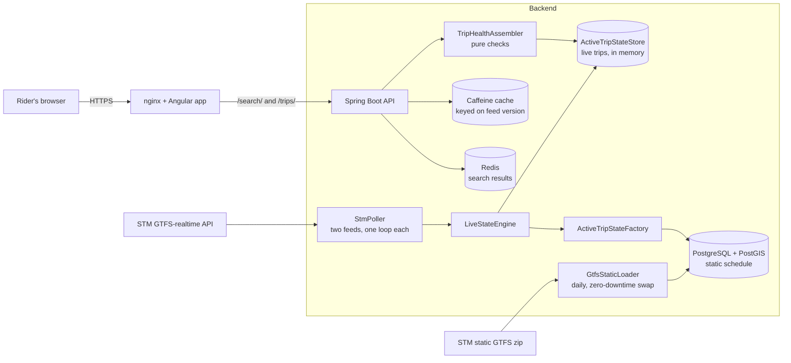

# MonArret

A trip health page for STM bus riders in Montréal. Pick a route and a direction, then a stop and a departure time. MonArret finds that one trip and tells you, in plain language, what is going on with it right now.

It combines what STM's real-time feed states directly with what the system works out by checking live positions against the static schedule and the route geometry. It shows facts, not scores, and it only speaks up when something matters. There is no map. The interface is in English and French.

## What the page shows

- **Trip status:** live (with the age of the position), cancelled, not tracked yet, signal lost, trip finished, or live data unavailable
- **Your stop:** whether the trip skips the stop you picked
- **Bus progress:** how many stops away the bus is and which stop it is heading to, or that it has already passed
- **Timing:** the scheduled departure next to STM's predicted departure, highlighted only when the bus is about 2 minutes early or 5 or more late
- **Crowding:** how full the bus is, as STM reports it
- **Road:** whether the bus is following its scheduled route
- **Stopped for N min:** how long a bus has sat in one place

## Architecture

The static schedule is loaded into PostgreSQL once a day and swapped in without downtime. The live feeds are polled every 20 seconds into an in-memory store with one state per running trip, and each request for a page reads that store.

## Built with

Java 21, Spring Boot 4, PostgreSQL with PostGIS, Redis · Angular 22 · Docker Compose

## Data

Transit data: [Société de transport de Montréal (STM)](https://www.stm.info/en/about/developers), licensed [CC BY 4.0](https://creativecommons.org/licenses/by/4.0/).

MonArret is an independent project. It is not affiliated with or endorsed by the STM. Data is provided as is, with no guarantee of accuracy.
