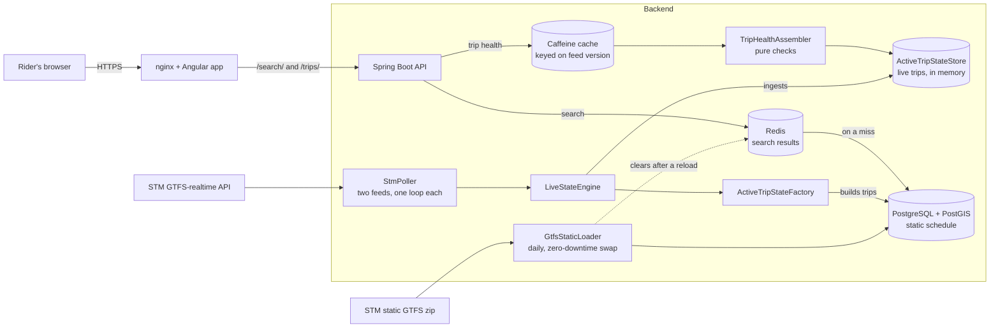

# MonArret

A trip health page for STM bus riders in Montréal. Pick a route and a direction, then a stop and a departure time. MonArret finds that one trip and tells you, in plain language, what is going on with it right now.

It combines what STM's real-time feed states directly with what the system works out by checking live positions against the static schedule and the route geometry. It shows facts, not scores, and it only speaks up when something matters. There is no map. The interface is in English and French.

## Why MonArret

Transit apps are built around maps, routing and trip planning across many agencies, and they do those things very well. A rider who is already at a stop with a specific bus in mind is asking something narrower: *is this trip okay?* Answering it usually means watching a moving dot on a map, or reading an arrival time with no explanation, and working out the rest alone.

MonArret takes that one question, and the rider's trip at their stop as its unit, and answers it in plain sentences: the bus is moving, it has been stopped for 5 minutes, it is running 6 minutes late, it skips your stop, it is not following its scheduled route. **It describes instead of drawing.** It is deliberately narrow: one question and, for now, one agency (STM buses in Montréal). The approach applies to any agency that publishes GTFS and GTFS-realtime data, though each agency's quirks need handling, as STM's did.

## What the page shows

- **Trip status:** live (with the age of the position), cancelled, not tracked yet, signal lost, trip finished, or live data unavailable
- **Your stop:** whether the trip skips the stop you picked
- **Bus progress:** how many stops away the bus is and which stop it is heading to, or that it has already passed
- **Timing:** the scheduled departure next to STM's predicted departure, highlighted only when the bus is about 2 minutes early or 5 or more late
- **Crowding:** how full the bus is, as STM reports it
- **Road:** whether the bus is following its scheduled route
- **Stopped for N min:** how long a bus has sat in one place

## Architecture

The static schedule is loaded into PostgreSQL once a day and swapped in without downtime. The live feeds are polled every 20 seconds into an in-memory store with one state per running trip, and each request for a page reads that store. The searches behind the picker are answered from a Redis cache and fall back to PostgreSQL.

## Built with

- **Backend:** Java 21, Spring Boot 4 (MVC API, Reactor for the feed pipeline), PostgreSQL with PostGIS, Redis, Caffeine
- **Frontend:** Angular 22, Transloco (English and French)
- **Delivery:** nginx, Docker Compose

## Data

Transit data: [Société de transport de Montréal (STM)](https://www.stm.info/en/about/developers), licensed [CC BY 4.0](https://creativecommons.org/licenses/by/4.0/).

MonArret is an independent project. It is not affiliated with or endorsed by the STM. Data is provided as is, with no guarantee of accuracy.

## License

All rights reserved. The source is published so that it can be viewed; copying, modification and redistribution are not permitted without permission. See [LICENSE](LICENSE).
